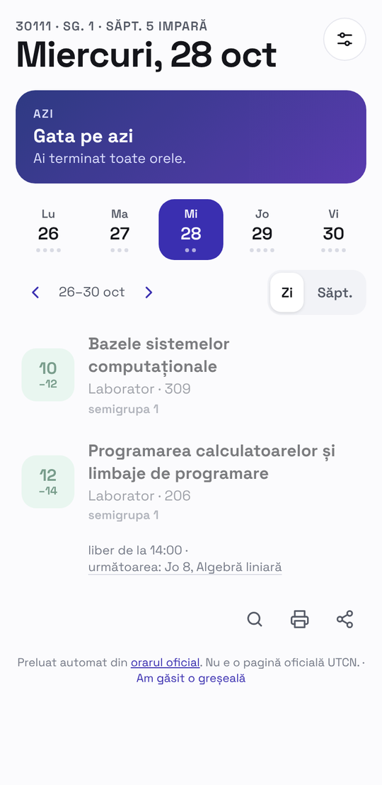
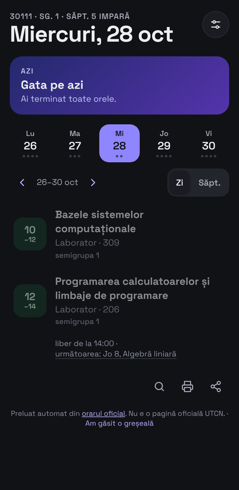
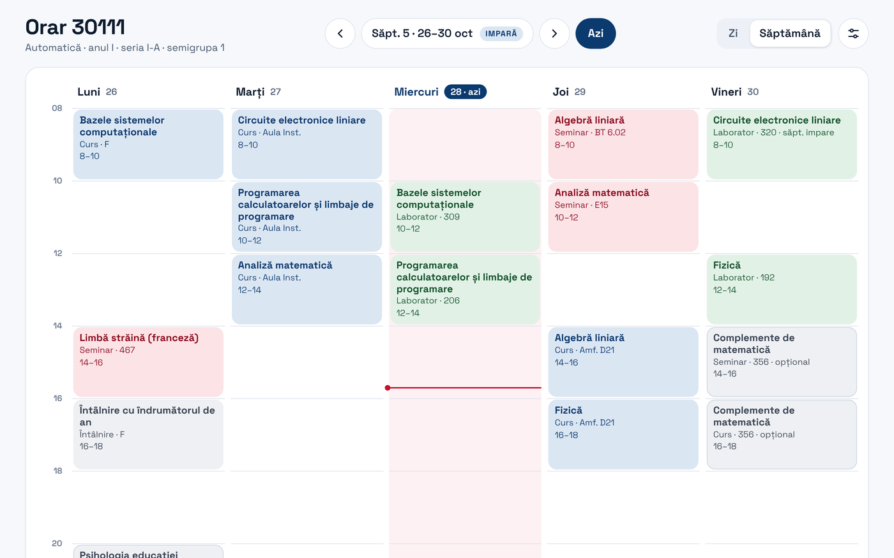

<p align="center"></p>

<p align="center">
  <a href="https://utcna.pages.dev"></a>
  
  
  
  
</p>

**UTCN Timetable** is a mobile-first timetable for the faculties of the Technical University of Cluj-Napoca. Pick your faculty, group and subgroup and see your day: week parity, rooms and teachers included. It reads the official timetables by itself every hour, so it never falls behind.

> Pulled automatically from the official timetables. **This is not an official UTCN page.** If anything differs, the official timetable wins. The app itself is in Romanian.

<p align="center">
  
  &nbsp;
  
</p>
<p align="center"></p>

## Features

- **8 sources in one place:** Automatică, Calculatoare, IE, ETTI, ARMM, Construcții, Instalații and IIRMP (bachelor's, Cluj campus; not the Alba, Bistrița, Satu Mare or Zalău extensions).
- **Day view on phones, week view on desktop**, with odd/even week parity, week ranges ("weeks 1–7") and a "Today" button.
- **Teachers on every class**, foreign-language groups with a language picker, and optional subjects (pedagogy, math complements, electives).
- **5 themes:** UTCN, dark, light, AMOLED and classic, plus a light print layout.
- **`.ics` calendars** for every group and subgroup, ready for Google Calendar or Apple Calendar.
- **Change log** (the last 60 changes) shown in the app, so you can see what moved.
- **Installable PWA** that works offline after the first visit. Shared links keep your group.

## How it works

```
official timetables (Excel, Google Sheets, PDF, EduPage)
        │   every hour, GitHub Actions
        ▼
 scripts/build.mjs ── lib/*.mjs   (Excel: exceljs)
                  └── pdf/*.py    (PDF: pdfplumber, one module per faculty)
        │   normalized data, only when what a student sees has changed
        ▼
 public/data/*.json + public/ics/*.ics + changes.json
        │   wrangler pages deploy
        ▼
 Cloudflare Pages  →  utcna.pages.dev
```

- A faculty whose download fails **keeps its previous data** and the build carries on. A source that parses to 0 groups never overwrites good data.
- EduPage (Construcții) sometimes refuses GitHub runner IPs. The two calls then go through an allow-listed Cloudflare Worker relay (set the `EDUPAGE_RELAY` repository variable to its URL).
- Each faculty's data lives in `public/data/<faculty>.json`: `groups[]` and `entries[group][]` (`d` day, `s`–`e` hours, `p` parity, `k` kind, `a`/`t` subject, `r` room, `sg` subgroups, `prof`, `pl` place).

## Run it locally

You need Node 20+ and Python 3.11+.

```bash
npm ci
pip install -r pdf/requirements.txt
node scripts/build.mjs --fetch                  # every source, from the internet
node scripts/build.mjs --only iirmp --fetch     # a single faculty
python3 -m http.server 8765 -d public           # http://localhost:8765
```

A PDF parser can also run on its own against saved files: `python3 pdf/iirmp.py path/to/pdfs > out.json`.

## Deploy it on your own account

1. Create a **Cloudflare Pages** project (Direct Upload) and an API token with "Cloudflare Pages: Edit".
2. In your GitHub repo → Settings → Secrets and variables → Actions, add:
   - secrets: `CLOUDFLARE_API_TOKEN`, `CLOUDFLARE_ACCOUNT_ID`;
   - variables: `CF_PROJECT` (the Pages project name), `ORAR_URL` (the SharePoint link of the Automatică timetable) and, optionally, `EDUPAGE_RELAY`.
3. Run the **Update timetables** workflow once. After that it runs by itself every hour from 7 to 22 on weekdays, and twice a day at weekends.

With every new release of the site, bump `const V = "orar-v2-N"` in `public/sw.js` so phones pick up the new version.

## Layout

| Path | What's in it |
|---|---|
| `public/` | The app (`index.html`, `sw.js`, manifest, icons) and the generated data |
| `scripts/build.mjs` | The main build, with each faculty's source |
| `lib/` | Excel parsers, titles, rooms and buildings, `.ics` calendars |
| `pdf/` | The PDF grid reader and one module per faculty |
| `.github/workflows/update.yml` | The hourly update and publish |

## Contributing

Found a wrong or missing class? Open an issue with the group and what should be there. Still missing: IMM, FAU, the master's programmes and ETTI SICAS.

## License

[MIT](LICENSE) for the code. The timetables belong to UTCN.
